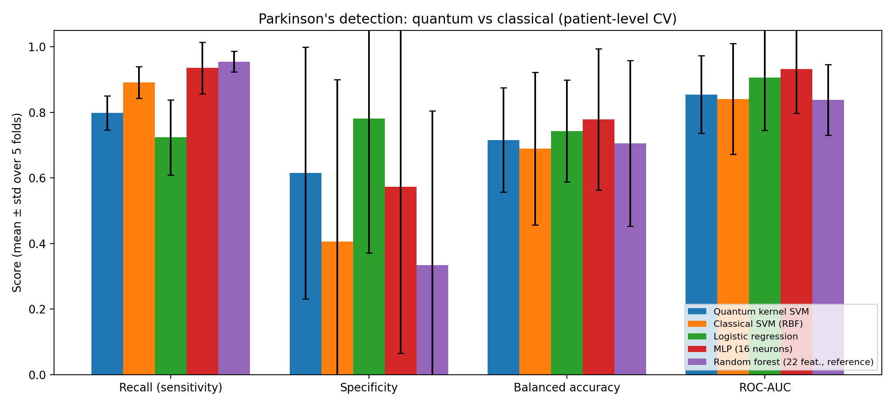
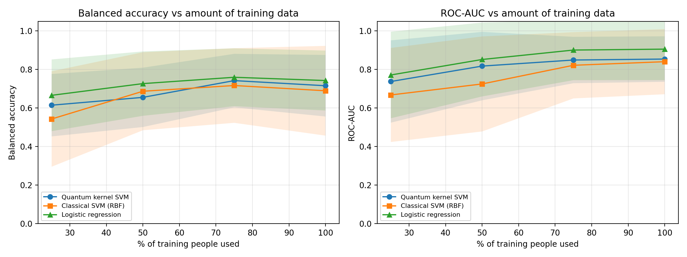
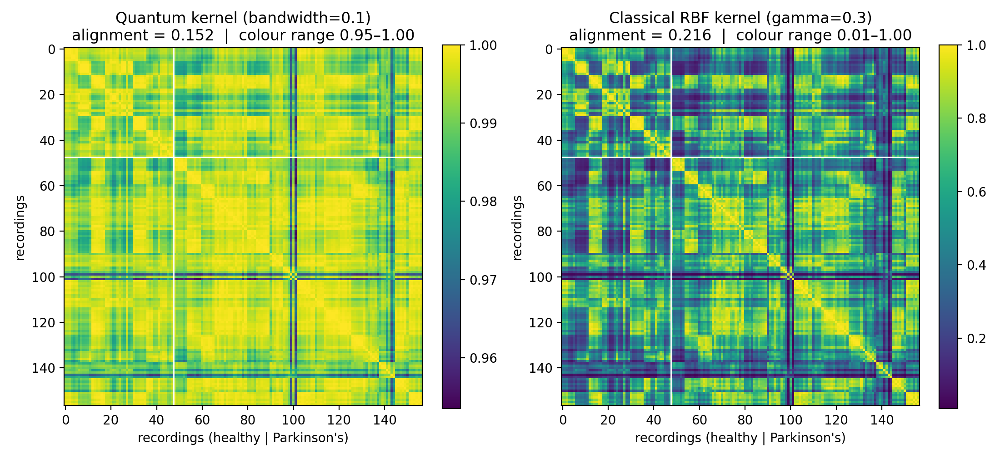

# Quantum Machine Learning for Parkinson's Disease Detection from Voice

## 1. Problem
Parkinson's disease often changes the voice (more pitch and loudness instability, more breathiness), and these changes can be measured from a short recording. A voice test is cheap, non-invasive and can be done remotely, which makes it attractive for early screening.

**Task:** given 22 acoustic measurements from a voice recording, predict Parkinson's (1) or healthy (0).

**Data:** UCI Parkinson's dataset (Little et al., 2008): 195 recordings from 31 people (23 with Parkinson's, 8 healthy), about 6 recordings per person.

## 2. Why quantum?
Medical datasets are often very small. With only 31 people, classical models are at high risk of overfitting and of unstable performance.

We test whether a **quantum kernel**, which maps each patient into a 16-dimensional entangled quantum state space, gives a better or more stable notion of patient similarity than a classical kernel, especially when the amount of training data is reduced even further.

## 3. Method

**Patient-level splitting.** 5-fold `StratifiedGroupKFold`: all recordings of a person are either in training or in test, never both. Random recording-level splits let a model recognise a person's voice instead of detecting the disease, which inflates scores. The kernel heatmaps (Section 4.3) show this directly: recordings of the same person form tight blocks of high similarity.

**Shared preprocessing** (fitted on training folds only): standardisation → PCA to 4 components (one per qubit) → rescaling to [0, π] (rotation angles).

**Quantum model.** IQP feature map on 4 qubits (Havlíček et al., 2019): Hadamard on every qubit, `RZ(xᵢ)` encoding, entangling `ZZ(xᵢ·xⱼ)` interactions on all pairs, repeated twice. Kernel: k(a, b) = |⟨ψ(a)|ψ(b)⟩|², used in a support vector machine. Simulated with PennyLane (`default.qubit`). A bandwidth factor scales the features before encoding.

**Main classical baseline.** SVM with RBF kernel on the same 4 features, with the same SVM, the same tuning code and the same splits. **The only difference between the two models is the kernel.**

**Additional baselines.** Logistic regression and an MLP (16 hidden neurons) on the same 4 features; random forest on all 22 original features as a reference ceiling.

**Tuning.** `C` and the kernel parameter (quantum bandwidth in {0.02 … 1.5}, RBF gamma in {0.01 … 1.0}) chosen by inner 3-fold patient-level cross-validation on balanced accuracy. The test fold is never used for tuning.

**Metrics.** Recall (sensitivity), specificity, balanced accuracy, F1, ROC-AUC; mean ± standard deviation over the 5 outer folds.

**Low-data experiment.** Training on 25 / 50 / 75 / 100 % of the training people (stratified by class, 5 random draws per fraction and fold), always testing on the same held-out people.

## 4. Results

### 4.1 Main comparison (5-fold patient-level CV)

| Model | Recall | Specificity | Balanced acc. | F1 | ROC-AUC |
|---|---|---|---|---|---|
| **Quantum kernel SVM** | 0.798 ± 0.052 | **0.615 ± 0.384** | **0.716 ± 0.160** | 0.814 ± 0.068 | **0.854 ± 0.118** |
| Classical SVM (RBF) | 0.891 ± 0.048 | 0.406 ± 0.493 | 0.690 ± 0.233 | 0.846 ± 0.087 | 0.841 ± 0.169 |
| Logistic regression | 0.724 ± 0.115 | 0.781 ± 0.410 | 0.743 ± 0.156 | 0.798 ± 0.063 | 0.906 ± 0.161 |
| MLP (16 neurons) | 0.935 ± 0.078 | 0.573 ± 0.507 | 0.778 ± 0.216 | 0.862 ± 0.129 | 0.931 ± 0.134 |
| Random forest (22 feat., reference) | 0.955 ± 0.032 | 0.333 ± 0.471 | 0.705 ± 0.253 | 0.859 ± 0.128 | 0.838 ± 0.108 |

Bold marks where the quantum SVM beats its matched classical baseline (Classical SVM, RBF).



### 4.2 Low-data experiment (ROC-AUC, mean over folds and draws)

| Training people used | Quantum kernel SVM | Classical SVM (RBF) | Difference | Logistic regression |
|---|---|---|---|---|
| 25 % | **0.738** ± 0.213 | 0.668 ± 0.244 | +0.070 | 0.772 ± 0.224 |
| 50 % | **0.818** ± 0.178 | 0.725 ± 0.247 | +0.093 | 0.852 ± 0.192 |
| 75 % | **0.849** ± 0.120 | 0.822 ± 0.172 | +0.027 | 0.901 ± 0.156 |
| 100 % | **0.854** ± 0.118 | 0.841 ± 0.169 | +0.013 | 0.906 ± 0.161 |

Balanced accuracy at 25 % of training people: quantum 0.615 ± 0.162 vs classical SVM 0.543 ± 0.248.



### 4.3 Kernel matrices (fold 1)



In fold 1 the tuned quantum kernel (bandwidth 0.1) has values between 0.954 and 1.000; the RBF kernel ranges from 0.007 to 1.000. Both kernels show the same block structure, including small blocks formed by the repeated recordings of each person. Kernel–target alignment in this fold is 0.152 (quantum) vs 0.216 (RBF).

### 4.4 Key findings

1. **The quantum kernel SVM outperforms its matched classical SVM** on balanced accuracy (0.716 vs 0.690), ROC-AUC (0.854 vs 0.841) and specificity (0.615 vs 0.406), with **lower variance on every metric**. The classical SVM's higher recall comes mostly from labelling nearly everyone as Parkinson's, as its low specificity shows.
2. **The quantum advantage is largest when data is scarcest.** The ROC-AUC gap over the classical SVM is +0.070 at 25 % and +0.093 at 50 % of training people, shrinking to +0.013 with all data. This supports our hypothesis that quantum kernels can help in small-data medical settings.
3. **The quantum model does not beat every classical model.** Logistic regression (ROC-AUC 0.906) and the MLP (0.931) score higher overall. On this dataset simple, well-regularised models remain very strong.
4. **The improvement is consistent but not statistically significant.** Error bars overlap because each test fold contains only about 6 people.

## 5. Limitations
- Results come from a noiseless simulator; real quantum hardware adds noise that could reduce performance.
- The dataset is small (31 people). Each test fold holds only 1–2 healthy people, so specificity varies strongly (± 0.4–0.5) and confidence intervals are wide.
- The tuned quantum bandwidth varied across folds (0.05 to 1.0), showing that hyperparameter selection is unstable on so little data.
- In fold 1, the quantum kernel's values are compressed into a narrow range (0.954–1.000) and its alignment with the labels is lower than the RBF kernel's; the gain is visible in averaged performance rather than in every individual fold.
- 4 qubits are easy to simulate classically. This study tests whether quantum kernels are *useful* for this problem, not whether they give a computational speed-up.

## 6. Future work
- Run the same kernel on real quantum hardware or a noisy simulator.
- Validate on larger voice datasets with more healthy participants.
- Try trainable quantum kernels and more qubits (more PCA components).
- Use repeated cross-validation and statistical tests to measure significance.

## 7. How to run
1. Open `parkinsons_quantum_ml.ipynb` in Google Colab.
2. Click *Runtime → Run all* (about 2–5 minutes).
3. The dataset downloads automatically; if not, upload `parkinsons.data` when prompted.

Outputs: `results/` (CSV tables) and `figures/` (PNG charts).

## 8. Project structure
```
QML_Parkinsons/
├── parkinsons_quantum_ml.ipynb   # full code with outputs
├── README.md                     # this report
├── parkinsons.data               # UCI dataset
├── results/
│   ├── results_summary.csv
│   ├── results_per_fold.csv
│   └── results_low_data.csv
└── figures/
    ├── main_comparison.png
    ├── low_data_experiment.png
    └── kernel_matrices.png
```

## Reference
Little, M. A., McSharry, P. E., Hunter, E. J., Spielman, J., & Ramig, L. O. (2008). Suitability of dysphonia measurements for telemonitoring of Parkinson's disease. *IEEE Transactions on Biomedical Engineering*.
Havlíček, V., et al. (2019). Supervised learning with quantum-enhanced feature spaces. *Nature*, 567, 209–212.
